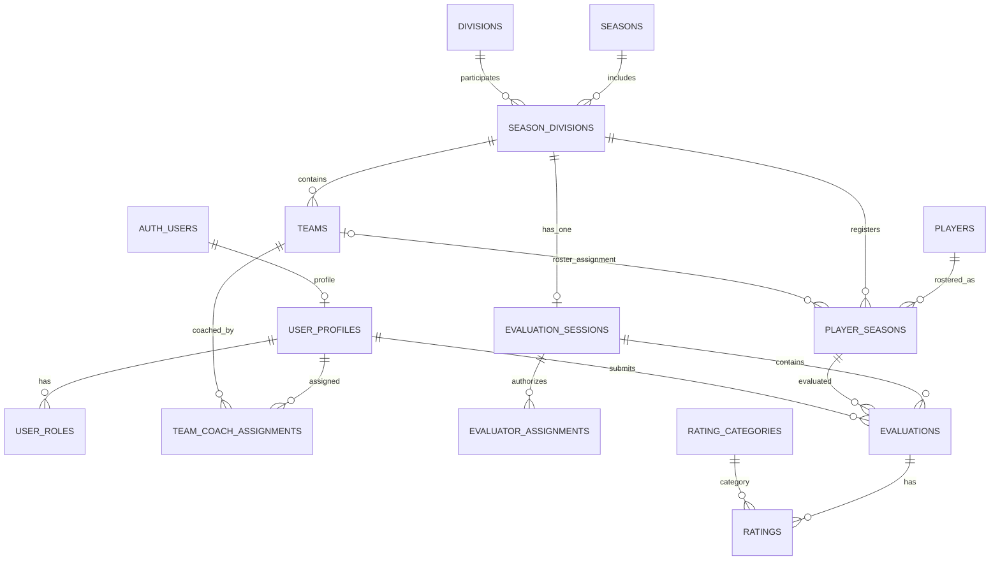

# RWCLL Player Evaluations — Proposed Database Design

**Status:** Proposed design; not implemented. The choices in this document reflect confirmed product requirements and database-design decisions confirmed on 2026-11-02. Review this design before writing or applying migrations.

## Confirmed design decisions

1. A coach may be assigned to multiple teams in a season.
2. Coaches can view group averages for both their assigned teams and the wider division.
3. There is one evaluation session per division per season. Multiple coaches and independent evaluators participate in that session.
4. Coach and independent-evaluator results remain separate. Coaches see aggregate results only, never individual ratings. Independent evaluator identities are hidden from coaches.
5. Administrators can inspect individual submissions.
6. A Not Evaluated record contains no ratings and is excluded from averages.
7. Historical evaluations are read-only and excluded from current-season averages.
8. A player may appear on only one roster in a season; the player may move to another team in a later season.
9. Each player has a season-specific `evaluation_number` that matches the number the player wears during evaluations. It is not the permanent player ID or a jersey number carried forward to future seasons.
10. A completed season is closed by default and remains viewable. Reopening requires an explicit administrator-only action for corrections and must be audit-logged; the season can be closed again.
11. Creating a new season carries forward only the editable division setup. Do not copy teams/team names, coach assignments, player evaluations, or historical results. Coaches are registered/assigned anew each season; team names are added after evaluations.

## Proposed tables

### Season, roster, and player identity

| Table | Purpose / important fields |
|---|---|
| `seasons` | One row per league season; name, start/end dates, lifecycle status (for example, setup/open/closed), closure metadata, and timestamps. |
| `divisions` | Tee Ball, A, AA, AAA, Majors, Juniors, Seniors. |
| `season_divisions` | A division participating in a particular season; unique season/division pair. |
| `teams` | Team within a `season_division`; team name and season/division association. |
| `players` | Stable player identity across seasons; randomly generated internal `player_id` (UUID primary key), name, and only the minimum personal data needed. Never derive the primary key from name or birthdate. |
| `player_seasons` | Player's season-specific roster record; `player_id`, `season_id`, `season_division_id`, optional `team_id`, `league_age`, `evaluation_number`, external registration identifier if available, import/match status. |

Season setup and carry-forward: keep each season as a separate record and never overwrite a prior season when starting a new one. When an administrator creates a new season, offer to carry forward only the division configuration from the previous season. Treat copied divisions as editable setup for the new season, not as shared rows that mutate prior seasons. The typical evaluation divisions are AA, AAA, Majors, Juniors, and Seniors, but administrators can edit which divisions apply to a season. Do not copy team names, coach assignments, player evaluations, or historical results. Coaches are registered and assigned anew each season, and team names are entered only after evaluations are complete.

Season lifecycle: model season lifecycle explicitly (for example, setup/open/closed), rather than relying only on an `active` boolean. After completion, a season is closed by default: authorized users may view its data, but ordinary workflows must not modify historical rosters, assignments, or evaluations. Only an administrator may invoke a deliberate reopen action for a correction. Require a reason and record administrator ID, timestamp, action, and reason in `audit_log`; allow the administrator to close the season again. Enforce these rules server-side/database-side, not only by hiding UI controls. Season closure is separate from evaluation-session status: locking a session governs evaluation submissions, while season closure governs changes to the season's historical records. Define and test exactly which exceptional correction operations are permitted during a reopen before implementation.

Use one stable `players` row per child and a separate `player_seasons` row per season. Include `season_id` directly on `player_seasons` so the database can enforce `UNIQUE (player_id, season_id)`: a player can have only one roster record—and therefore at most one team assignment—in a given season, even if they change teams or divisions in a later season. Retain `season_division_id` on the roster row so a player can be registered in a division before a team is assigned. Use a composite foreign key or equivalent constraint to ensure the `season_division_id` belongs to the same `season_id`; if `team_id` is present, validate that the team belongs to that same season division.

`evaluation_number` is a season-specific integer stored on `player_seasons`. It is the number shown on the evaluation screen so coaches/evaluators can match the on-screen player to the number the child is wearing during the evaluation. It is not a permanent player identifier and must not be copied forward to the next season. Assign a fresh number each season. Because there is one session per division per season, require assigned values to be unique within a `season_division` (for example, a partial unique index on `(season_division_id, evaluation_number)` where `evaluation_number IS NOT NULL`). The field can remain null until an administrator assigns the evaluation number. It must not be confused with a permanent player ID or assumed to be a jersey number that persists across seasons.

Calculate Little League age for each season using the official Aug. 31 rule. Store the season-specific result; do not treat birthdate as a substitute for league age. Confirm whether the league needs to retain full birthdates after import. The Sports Connect export inspected for this project did not contain a stable member ID. Generate a permanent internal `player_id` (UUID) when a player record is created; never build it from name or birthdate. During import, use normalized name and birthdate only to suggest possible matches. Show the administrator the source row and candidate records, require an explicit confirmation before linking to an existing player, and allow creation of a new player when no candidate is confirmed. Ambiguous or uncertain rows must remain pending review and must not be silently merged. Record the import batch and the administrator decision in an audit-friendly way. If a stable external ID becomes available later, it may be stored as a matching attribute but should not replace the internal primary key.

### Users and team assignments

| Table | Purpose / important fields |
|---|---|
| Supabase `auth.users` | Authentication identity managed by Supabase. |
| `user_profiles` | Application profile linked one-to-one to `auth.users`; display name and active status. |
| `user_roles` | One or more roles per user, such as administrator, coach, independent evaluator. |
| `team_coach_assignments` | Season-scoped many-to-many link between a coach and a team. Include `season_id`, `team_id`, `user_id`, active dates/status, and who created the assignment. |

A coach may have multiple rows in `team_coach_assignments`, including assignments to several teams in the same season. Scope assignments to a season so they do not accidentally carry forward to a new season. Validate that the assigned team belongs to the specified season.

Do not create a separate password system. A Supabase-authenticated account is not automatically authorized to access league data; application roles and row-level security (RLS) determine access.

### Evaluation session and submissions

| Table | Purpose / important fields |
|---|---|
| `evaluation_sessions` | Exactly one session for each `season_division`; status (planned/open/locked), lock metadata, and administrative timestamps. Enforce a unique `season_division_id`. |
| `evaluator_assignments` | Users authorized to evaluate in a session; evaluator group/type (coach or independent evaluator), assignment status. |
| `evaluations` | One evaluator's evaluation of one player in one session; evaluator user ID, player-season ID, status (draft/submitted/not_evaluated), timestamps. |
| `rating_categories` | Configurable rating category definitions and ordering. |
| `division_rating_categories` | Which categories apply to each season division and whether each is required. |
| `ratings` | Individual category scores, constrained to 1–5, linked to an evaluation and category. |
| `experience_answers` | Yes/No/Unknown answers for prior pitching/catching experience and interest. |

The one-session-per-division rule is represented by one `evaluation_sessions` row per `season_division`, not by one session per evaluator. Multiple evaluator assignments point to the same session. Multiple evaluators can independently submit an evaluation for the same player.

Add a uniqueness constraint so an evaluator cannot create duplicate evaluation records for the same player in the same session. The evaluation screen should display the player's season-specific `evaluation_number` prominently alongside the player record, so evaluators can identify the player by the number being worn. Do not use `evaluation_number` as the evaluation foreign key or as a stable player identifier. If a coach evaluates a player in more than one assigned team context, use the player's single season roster record and the division session; do not duplicate the player's evaluation merely because the coach has multiple team assignments.

For a submitted evaluation, require all five core categories: Hitting, Throwing, Grounders, Fly balls, and Running / Awareness. Pitching and catching categories are optional for AAA, Majors, Juniors, and Seniors. Experience/interest questions use Yes/No/Unknown and are not numeric ratings. A Not Evaluated submission has no `ratings` rows and must never be converted to a zero score. Drafts are not included in averages.

### Notes, historical data, imports, and audit

| Table | Purpose / important fields |
|---|---|
| `private_notes` | Coach's private notes, visible only to that coach and administrators. |
| `shared_notes` | Notes intentionally shared with authorized league users; final visibility rules still need confirmation. |
| `historical_evaluations` | Imported prior-season evaluation records, marked read-only and source/coverage-labeled. |
| `historical_ratings` | Category-level historical scores; never included in current averages. |
| `import_batches` | Source file, import date, importing administrator, counts, and batch status. |
| `audit_log` | Important actions, actor, target record, timestamp, and safe change metadata. |

Keep private and shared notes in separate tables and policies. A shared-note permission must not grant access to private notes or individual scores. Historical AA data currently represents only one team's records and should be labeled as partial coverage. It requires unredacted names or a reliable mapping and administrator-confirmed player matching before import.

## Relationships (conceptual)

This diagram is conceptual. Exact foreign keys, nullable fields, delete behavior, and constraints must be finalized in SQL migrations.

## Coach views and average calculations

Provide two authorized aggregate scopes to coaches:

- **Assigned-team view:** group averages for each team to which that coach is assigned for the season.
- **Division-wide view:** group averages across the division.

For both scopes, calculate coach-submitted and independent-evaluator-submitted averages separately. Never combine the two evaluator groups. Show the number of actual ratings used alongside each average, such as `4.2 (5 of 6 evaluators)`. Only submitted numeric ratings count; drafts, Not Evaluated submissions, and blank optional categories do not count. Historical scores are displayed separately as context and never enter current averages.

The application must not give coaches direct read access to individual `ratings` or `evaluations` rows in a way that lets them reconstruct individual scores. Use carefully scoped database views or, preferably where needed, security-definer functions/RPCs that return only approved aggregates. Review function ownership, `search_path`, grants, and RLS carefully. Do not rely on frontend filtering to hide individual scores. Test team and division aggregates using separate coach accounts with different team assignments, plus independent evaluator and administrator accounts.

Independent evaluator names/IDs must not appear in coach-facing aggregate responses or notes. Administrators retain authorized access to individual submissions and audit records.

## Security and implementation requirements

- Enable RLS on every table containing league or child data.
- Deny access by default; grant only the minimum required actions by role and assignment.
- Enforce coach access to assigned-team and division aggregate outputs without exposing individual score rows.
- Restrict individual evaluation records and raw ratings to their author where appropriate and to administrators; independent-evaluator identity is not exposed to coaches.
- Restrict private coach notes to their author and administrators.
- Lock sessions administratively and reject writes after lock, including direct API/database attempts.
- Preserve author, creation/submission timestamps, and audit events.
- Use test accounts for every role and test both allowed and denied operations before importing real children’s data.
- Keep service-role/secret keys server-side only; never expose them in browser code.

## Still to confirm before implementation

- Final visibility rules for shared coach notes.
- Whether historical AA ratings should be visible only for the matching player and how to present missing historical coverage.
- Whether a player can be rostered without a team at evaluation time (the proposed design allows a nullable `team_id`); the one-roster-per-player-per-season rule and evaluation-number uniqueness scope are confirmed.
- Whether the league needs to retain full birthdates after import, and for how long.
- Data retention policy for children’s names and birthdates.

## Implementation status

No RWCLL tables, migrations, aggregate functions, or RLS policies have been created yet. The existing successful sign-in test verifies Supabase Auth only; it does not verify this proposed database design.
