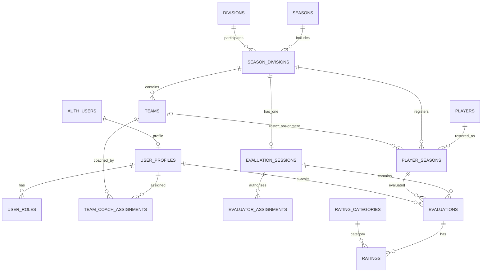

# RWCLL Player Evaluations — Proposed Database Design

**Status:** Earlier proposed design; sections describing division-based evaluation sessions and mandatory division assignment are superseded by the 2026-11-03 workflow below. The proposed replacement is not implemented. The choices in this document reflect confirmed product requirements and database-design decisions confirmed on 2026-11-02. Review this design before writing or applying migrations.

## Confirmed design decisions

1. A coach may be assigned to multiple teams in a season.
2. Coach-facing views must not show a comparison of assigned-team averages against division-wide averages; avoid juxtaposing those scopes for coaches.
3. Superseded 2026-11-03: evaluation events are organized by age group, with primary and makeup events; a group may span eventual divisions.
4. Coach and independent-evaluator results remain separate. Coaches see aggregate results only, never individual ratings. Independent evaluator identities are hidden from coaches.
5. Administrators can inspect individual submissions.
6. A Not Evaluated record contains no ratings and is excluded from averages.
7. Historical evaluations are read-only and excluded from current-season averages.
8. A player may appear on only one roster in a season; the player may move to another team in a later season.
9. Each player has a season-specific `evaluation_number` that matches the number the player wears during evaluations. It is not the permanent player ID or a jersey number carried forward to future seasons.
10. A completed season is closed by default and remains viewable. Reopening requires an explicit administrator-only action for corrections and must be audit-logged; the season can be closed again.
11. Creating a new season carries forward only the editable division setup. Do not copy teams/team names, coach assignments, player evaluations, or historical results. Coaches are registered/assigned anew each season; team names are added after evaluations.

## Superseding design decision — age-based evaluation workflow (2026-11-03)

This is the current target design and supersedes the older division-based tables and requirements below. It is a proposal, not an implemented schema or executable migration.

### Proposed logical entities

| Entity | Responsibility and key rules |
|---|---|
| `players` | Permanent internal player identity across seasons. Internal ID is generated by the app/database and is never derived from name, birthdate, or Sports Connect ID. Store only approved necessary personal data. |
| `player_seasons` (or a successor `season_registrations`) | One registration per internal player per season. Must not require a division or team before evaluation. Store calculated season Little League age, season-scoped Sports Connect Player ID, source program/division labels, registration/payment status (`Completed`, `Pending`, or an explicit unmapped value), import/review status, and nullable evaluation/registration number. Preserve `UNIQUE(player_id, season_id)`. |
| `import_batches` and `import_rows` (new detail table proposed) | Record file metadata, selected season, counts, row-level validation outcomes, candidate matches, administrator decisions, and commit status. Avoid storing uploaded file bytes or unnecessary account contact data by default. |
| `season_divisions` | Defines active divisions for the season: AA, AAA, Majors, Juniors, Seniors by default. This is configuration, not a prerequisite for player import/evaluation. Out-of-scope source programs are imported and flagged, not automatically added to this set. |
| `evaluation_groups` (new) | Age-based grouping within a season, based on official Little League age; a group may contain players who later enter different divisions. Do not use a final division as the group key. |
| `evaluation_sessions` (rework existing) | A dated event linked to an age group, with type `primary` or `makeup`, status/lock state, and evaluator assignments. A group may have multiple events. Retain draft/lock/audit controls. |
| `evaluation_attendance` (new) | One row per player-season and event. Record attendance independently from scores, including present, absent, and any agreed excused/other status; record injury/limited participation separately where useful. Enforce one attendance record per player/event. |
| `evaluations` and child rating/answer/note tables (rework FKs) | Performance submissions linked to a player-season and event/evaluator, without requiring a division. An attending injured player may have no evaluation or a partial/incomplete evaluation; never create fake scores. Preserve separate coach/independent evaluator results, draft/submitted states, session locks, validation, and audited admin corrections. |
| `evaluation_exemptions` (new) | Explicit admin-approved scope: attendance requirement, evaluation requirement, or both; required reason, approver, timestamp, and audit event. An exemption is not inferred from absence or injury. |
| `division_age_rules` or equivalent season configuration (new) | Store the league-approved eligibility/top-age placement rules and approved exceptions for a season. Do not hard-code unverified thresholds. Enforce draft-order/eligibility constraints in app and database where feasible. |
| `teams` and `team_assignments` / roster relation | Teams and final division/team assignments are entered after the real-world draft. A player can be assigned to at most one team in a season. Draft order is Seniors → Juniors → Majors → AAA → AA, with each pool formed from remaining eligible players subject to mandatory age-placement rules. |
| `audit_log` | Preserve admin import decisions, identity linking, exemptions, roster assignment changes, and authorized corrections with actor/time/reason where appropriate. Direct untrusted audit writes remain prohibited. |

### Import preview and commit contract

1. Admin chooses the existing season (Spring 2027: 2027-01-01 to 2027-06-30) and uploads a CSV. Importing must never create a season implicitly.
2. Parse CSV safely and map source columns by known headers, allowing explicit admin mapping if headers differ. The supplied test file uses `Player Id`, `Player Birth Date`, `Division Name`, `Registration Number`, and `Order Payment Status`.
3. Validate required identity and age inputs, supported date formats, empty IDs, malformed rows, unknown payment-status values, and duplicate nonblank Player IDs within the file/season. Duplicate IDs are blocking conflicts; show every affected row and require resolution. Never silently merge.
4. Import all registration statuses, including `Completed` and `Pending`. Pending is a registration/payment status, not an evaluation-eligibility rule. Keep payment status out of evaluation screens and do not add payment-processing features.
5. Import registrations for A, Tee Ball, Wiffle Ball, and other out-of-scope programs, but mark them `needs_program_review` and exclude them from the active evaluation pool by default. Admin can explicitly resolve the flag.
6. Calculate Little League age using the supplied official 2027 baseball age chart/rule (age determined as of August 31, 2027). Validate chart/source before production use. Store the resulting season age so it is auditable and reproducible.
7. Existing-player matching is suggestion-only. Sports Connect ID, normalized name, and birthdate can generate candidates; none can auto-link. Admin explicitly chooses existing player, create new player, or leave pending review. A different external ID in another season must not block a match; the same external ID is not proof by itself.
8. If a registration number is present, preview it and validate uniqueness in the season. If blank, keep it null. Do not auto-generate numbers during import. Evaluation without a number must remain possible.
9. Preview counts and row-level outcomes: new internal players, matched existing players awaiting/after confirmation, new season registrations, updates to existing season registrations, duplicate conflicts, invalid rows, out-of-scope program flags, unknown statuses, and missing optional numbers. Show all changes before commit.
10. Commit must be an admin-only, transaction-safe, idempotent operation. A retry must not duplicate registrations. Preserve an import audit trail. If blocking conflicts remain, do not commit those rows; clearly show whether the admin may commit unaffected rows or must resolve the whole batch first (recommended initial behavior: resolve blocking duplicate-ID conflicts before committing the batch).
11. Registration status is visible on player lists/details/reports but never on evaluator/coaches' evaluation screen. Reports should show status where relevant, and pending registrations remain in the evaluation pool unless another independent eligibility rule applies.

### Attendance, injuries, makeup events, and exemptions

- All registered players in the active evaluation scope are expected at the primary event, even if injured; a player unable to attend can attend a makeup event.
- Track each player at each event. Attendance at a makeup event satisfies attendance tracking for that event but does not erase the primary absence; reports can show the combined requirement status.
- Attendance is not a score. Injury/limited participation can be recorded separately. Do not fabricate missing skill ratings.
- Admin exemption records must specify which requirement is waived (attendance, evaluation, or both), a reason, approving administrator, and timestamp. Exemptions must be auditable and visible to authorized admins.

### Draft and division assignment

- The app records draft outcomes; it does not conduct the official draft or replace Sports Connect/official rostering.
- Division/team assignment occurs after evaluation. Draft order is Seniors, Juniors, Majors, AAA, AA, with remaining eligible players flowing to younger division pools under configured rules.
- Mandatory top-age placement and approved exceptions require an explicit season configuration based on league-approved age rules. Do not guess thresholds or infer exceptions from ratings.
- Optional AA random team suggestions are advisory only, admin-reviewed, and separate from official roster assignment.

### Existing-schema impact and migration review

The current baseline migration has a required `player_seasons.season_division_id`, a unique index on `(season_division_id, evaluation_number)`, a unique `evaluation_sessions.season_division_id`, and foreign keys tying evaluations to the division-specific player/session. These constraints conflict with the new age-based workflow. `player_seasons` already has `UNIQUE(player_id, season_id)` and a season-scoped external-ID unique index, which are useful foundations.

Do not edit migrations that have already been applied. Proposed migration work must be additive/versioned and reviewed against both local and hosted schema states. Likely work: introduce age groups and event types; make the player-season registration independent of division; rework evaluation foreign keys/policies; move evaluation-number uniqueness to the season scope; add registration status and import-row review state; add attendance/exemption structures; and revise RLS/helper functions/reporting projections. Exact DDL and migration order are not yet approved. Do not run a hosted migration until a fresh local migration chain and role tests pass.

## Earlier division-based proposal (reference only; superseded where it conflicts with the age-based design)

## Proposed tables

### Season, roster, and player identity

| Table | Purpose / important fields |
|---|---|
| `seasons` | One row per league season; name, start/end dates, lifecycle status (for example, setup/open/closed), closure metadata, and timestamps. |
| `divisions` | Tee Ball, A, AA, AAA, Majors, Juniors, Seniors. |
| `season_divisions` | A division participating in a particular season; unique season/division pair. |
| `teams` | Team within a `season_division`; team name and season/division association. |
| `players` | Stable player identity across seasons; database-generated internal primary key (the current baseline uses bigint identity; do not change its type without an approved migration), name, and only minimum necessary personal data. Never derive the primary key from name or birthdate. |
| `player_seasons` | Player's season-specific roster record; `player_id`, `season_id`, `season_division_id`, optional `team_id`, `league_age`, `evaluation_number`, external registration identifier if available, import/match status. |

Season setup and carry-forward: keep each season as a separate record and never overwrite a prior season when starting a new one. When an administrator creates a new season, offer to carry forward only the division configuration from the previous season. Treat copied divisions as editable setup for the new season, not as shared rows that mutate prior seasons. The typical evaluation divisions are AA, AAA, Majors, Juniors, and Seniors, but administrators can edit which divisions apply to a season. Do not copy team names, coach assignments, player evaluations, or historical results. Coaches are registered and assigned anew each season, and team names are entered only after evaluations are complete.

Season lifecycle: model season lifecycle explicitly (for example, setup/open/closed), rather than relying only on an `active` boolean. After completion, a season is closed by default: authorized users may view its data, but ordinary workflows must not modify historical rosters, assignments, or evaluations. Only an administrator may invoke a deliberate reopen action for a correction. Require a reason and record administrator ID, timestamp, action, and reason in `audit_log`; allow the administrator to close the season again. Enforce these rules server-side/database-side, not only by hiding UI controls. Season closure is separate from evaluation-session status: locking a session governs evaluation submissions, while season closure governs changes to the season's historical records. Define and test exactly which exceptional correction operations are permitted during a reopen before implementation.

Use one stable `players` row per child and a separate `player_seasons` row per season. Include `season_id` directly on `player_seasons` so the database can enforce `UNIQUE (player_id, season_id)`: a player can have only one roster record—and therefore at most one team assignment—in a given season, even if they change teams or divisions in a later season. Retain `season_division_id` on the roster row so a player can be registered in a division before a team is assigned. Use a composite foreign key or equivalent constraint to ensure the `season_division_id` belongs to the same `season_id`; if `team_id` is present, validate that the team belongs to that same season division.

`evaluation_number` is a season-specific integer stored on `player_seasons`. It is the number shown on the evaluation screen so coaches/evaluators can match the on-screen player to the number the child is wearing during the evaluation. It is not a permanent player identifier and must not be copied forward to the next season. Assign a fresh number each season. Earlier proposal (superseded): number uniqueness was scoped to `season_division`. The revised age-group model needs a reviewed season-wide uniqueness rule, because age groups can span divisions. The field can remain null until an administrator assigns the evaluation number. It must not be confused with a permanent player ID or assumed to be a jersey number that persists across seasons.

Calculate Little League age for each season using the official Aug. 31 rule. Store the season-specific result; do not treat birthdate as a substitute for league age. Confirm whether the league needs to retain full birthdates after import. Sports Connect provides a player ID, but the league confirmed with Sports Connect that it is not a universal child identity: it may carry over across seasons when the same parent registers the child, yet a different parent registering that same child in a later season can result in a different ID. Therefore, treat the Sports Connect ID as a useful, season-scoped external registration identifier and matching clue—not as the app’s permanent player ID and not as proof that two records are different children. The current proposed `player_seasons.external_registration_id` field stores the identifier associated with that season’s registration; its uniqueness should be scoped to a season, not globally across seasons. Generate a permanent internal player key when a player record is created; the existing baseline key is bigint identity. Never build it from name, birthdate, or Sports Connect ID.

During import, show the administrator the source row and any candidate player records. A matching Sports Connect ID is useful evidence, but it does not bypass administrator confirmation. A different Sports Connect ID across seasons must not disqualify a possible returning-player match. Use normalized name and birthdate as additional candidate-generation clues only; neither is a guaranteed unique key. Require an explicit administrator decision before linking an import row to an existing player. If no candidate is confirmed, allow the administrator to create a new player; uncertain rows remain pending review. Never silently merge records or automatically create a duplicate when a plausible candidate needs review. Record the import batch, source row, candidate(s), decision, administrator, timestamp, and reason where appropriate in an audit-friendly way. If a future import supplies multiple external IDs for one child/season, hold the row for review rather than overwriting an existing ID or merging automatically.

#### Sports Connect identifier and import-matching rules

- The Sports Connect ID is not globally authoritative for child identity because a different registering parent can cause the same child to receive a different ID in a later season.
- Store the source ID on the season-specific registration (`player_seasons.external_registration_id`); do not use it as `players.id` or require it to match across seasons.
- Keep the existing season-scoped uniqueness rule for non-null external registration IDs, subject to the import review below. The same external ID may legitimately appear in different seasons.
- Import matching is a review workflow: same ID is a clue, a changed ID is not a disqualifier, and name/date of birth generate possible candidates rather than automatic links.
- Require explicit administrator confirmation for every link to an existing internal player. Preserve unresolved rows in a pending-review state and log the final decision.
- Test the cases listed in `docs/FAQ.md` before implementing or trusting import matching.

### Users and team assignments

| Table | Purpose / important fields |
|---|---|
| Supabase `auth.users` | Authentication identity managed by Supabase. |
| `user_profiles` | Application profile linked one-to-one to `auth.users`; display name and active status. |
| `user_roles` | One or more roles per user, such as administrator, coach, independent evaluator. |
| `team_coach_assignments` | Season-scoped many-to-many link between a coach and a team. Include `season_id`, `team_id`, `user_id`, active dates/status, and who created the assignment. |

A coach may have multiple rows in `team_coach_assignments`, including assignments to several teams in the same season. Scope assignments to a season so they do not accidentally carry forward to a new season. Validate that the assigned team belongs to the specified season.

Do not create a separate password system. A Supabase-authenticated account is not automatically authorized to access league data; application roles and row-level security (RLS) determine access.

### Evaluation session and submissions

| Table | Purpose / important fields |
|---|---|
| `evaluation_sessions` | Exactly one session for each `season_division`; status (planned/open/locked), lock metadata, and administrative timestamps. Enforce a unique `season_division_id`. |
| `evaluator_assignments` | Users authorized to evaluate in a session; evaluator group/type (coach or independent evaluator), assignment status. |
| `evaluations` | One evaluator's evaluation of one player in one session; evaluator user ID, player-season ID, status (draft/submitted/not_evaluated), timestamps. |
| `rating_categories` | Configurable rating category definitions and ordering. |
| `division_rating_categories` | Which categories apply to each season division and whether each is required. |
| `ratings` | Individual category scores, constrained to 1–5, linked to an evaluation and category. |
| `experience_answers` | Yes/No/Unknown answers for prior pitching/catching experience and interest. |

The one-session-per-division rule is represented by one `evaluation_sessions` row per `season_division`, not by one session per evaluator. Multiple evaluator assignments point to the same session. Multiple evaluators can independently submit an evaluation for the same player.

Add a uniqueness constraint so an evaluator cannot create duplicate evaluation records for the same player in the same session. The evaluation screen should display the player's season-specific `evaluation_number` prominently alongside the player record, so evaluators can identify the player by the number being worn. Do not use `evaluation_number` as the evaluation foreign key or as a stable player identifier. If a coach evaluates a player in more than one assigned team context, use the player's single season roster record and the division session; do not duplicate the player's evaluation merely because the coach has multiple team assignments.

For a submitted evaluation, require all five core categories: Hitting, Throwing, Grounders, Fly balls, and Running / Awareness. Pitching and catching categories are optional for AAA, Majors, Juniors, and Seniors. Experience/interest questions use Yes/No/Unknown and are not numeric ratings. A Not Evaluated submission has no `ratings` rows and must never be converted to a zero score. Drafts are not included in averages.

### Notes, historical data, imports, and audit

| Table | Purpose / important fields |
|---|---|
| `private_notes` | Coach's private notes, visible only to that coach and administrators. |
| `shared_notes` | Notes intentionally shared with authorized league users; final visibility rules still need confirmation. |
| `historical_evaluations` | Imported prior-season evaluation records, marked read-only and source/coverage-labeled. |
| `historical_ratings` | Category-level historical scores; never included in current averages. |
| `import_batches` | Source file, import date, importing administrator, counts, and batch status. |
| `audit_log` | Important actions, actor, target record, timestamp, and safe change metadata. |

Keep private and shared notes in separate tables and policies. A shared-note permission must not grant access to private notes or individual scores. Historical AA data currently represents only one team's records and should be labeled as partial coverage. It requires unredacted names or a reliable mapping and administrator-confirmed player matching before import.

## Relationships (conceptual)

This diagram is conceptual. Exact foreign keys, nullable fields, delete behavior, and constraints must be finalized in SQL migrations.

## Coach views and average calculations

Calculate group averages for assigned teams and division-wide groups as needed for authorized workflows, keeping coach-submitted and independent-evaluator-submitted averages separate. Never combine evaluator groups. Show counts alongside averages, such as `4.2 (5 of 6 evaluators)`. Only submitted numeric ratings count; drafts, Not Evaluated submissions, and blank optional categories do not count. Historical scores are displayed separately as context and never enter current averages. **Coach-facing screens must not compare or juxtapose assigned-team averages with division-wide averages.** Define and test the exact coach-facing presentation so that coaches cannot infer a team-versus-division comparison from the interface or exported coach-facing reports.

The application must not give coaches direct read access to individual `ratings` or `evaluations` rows in a way that lets them reconstruct individual scores. Use carefully scoped database views or, preferably where needed, security-definer functions/RPCs that return only approved aggregates. Review function ownership, `search_path`, grants, and RLS carefully. Do not rely on frontend filtering to hide individual scores. Test team and division aggregates using separate coach accounts with different team assignments, plus independent evaluator and administrator accounts.

Independent evaluator names/IDs must not appear in coach-facing aggregate responses or notes. Administrators retain authorized access to individual submissions and audit records.

## Security and implementation requirements

- Enable RLS on every table containing league or child data.
- Deny access by default; grant only the minimum required actions by role and assignment.
- Enforce coach access to assigned-team and division aggregate outputs without exposing individual score rows.
- Restrict individual evaluation records and raw ratings to their author where appropriate and to administrators; independent-evaluator identity is not exposed to coaches.
- Restrict private coach notes to their author and administrators.
- Lock sessions administratively and reject writes after lock, including direct API/database attempts.
- Preserve author, creation/submission timestamps, and audit events.
- Use test accounts for every role and test both allowed and denied operations before importing real children’s data.
- Keep service-role/secret keys server-side only; never expose them in browser code.

## Still to confirm before implementation

- Final visibility rules for shared coach notes.
- Whether historical AA ratings should be visible only for the matching player and how to present missing historical coverage.
- Whether a player can be rostered without a team at evaluation time (the proposed design allows a nullable `team_id`); the one-roster-per-player-per-season rule and evaluation-number uniqueness scope are confirmed.
- Whether the league needs to retain full birthdates after import, and for how long.
- Data retention policy for children’s names and birthdates.

## Implementation status

The initial RWCLL tables, helper/trigger functions, and RLS policies have been created directly in the Supabase SQL Editor. They have not yet been captured as version-controlled migration files. Some catalog and permission checks have passed, but the schema and policies are not yet fully reviewed or tested end-to-end. The successful sign-in test verifies Supabase Auth only; it does not verify database access behavior. Before production use, reconcile this design with the live schema, create migration files that faithfully represent the existing database, and test constraints, RLS, and reporting with separate test accounts and synthetic data.

## Additional workflow design requirements (confirmed 2026-11-02)

These requirements refine the proposed schema and policies. They remain design-only until implemented and tested.

### Evaluation numbers and absence tracking
- Keep `player_seasons.evaluation_number` nullable. A missing number must not prevent creating or submitting an evaluation.
- Admin workflow must support generating numbers from a chosen starting integer, manual overrides, and CSV import with validation and an import audit trail. Preserve the season-division uniqueness rule for non-null numbers.
- Add or define a per-player/per-session attendance status that can distinguish at least `present`, `absent`, and `not_recorded` (final naming may be refined during implementation). Absence is not a rating and must not be represented by zeroes.
- Provide an admin-only absence report. A player marked absent is flagged for admin resolution and is not eligible to play under the confirmed league rule until handled. The exact resolution states should be designed before implementation.

### Evaluator access, drafts, and session completion
- Evaluator search scope: any player in the evaluator's assigned division/session, not only a preselected player list. Coach evaluation access may span divisions, subject to explicit role/assignment authorization. Implement these rules through server-side checks and RLS/RPC design, not just hidden UI controls.
- Evaluations need explicit draft/submitted state and timestamps. Authors may edit their own submitted evaluations until the session is locked.
- Missing required ratings and missing evaluator submissions should be queryable flags/reports. They do not force the session to remain open; an administrator decides completion.
- After session lock, only administrators may correct a submitted evaluation. Preserve an audit entry including actor, timestamp, affected record, and correction details; avoid silent updates.

### Optional proposed-team generation
- This feature creates planning suggestions only. It must not create or change official team assignments unless a future, separately approved workflow explicitly does so.
- Input constraints include coach assignments first, target team size chosen by an administrator, and coach-child placement constraints. A coach-child designation is visible to all coaches. It may be used to automatically place the child on the designated coach's proposed team. Apply appropriate access controls to prevent unrelated private data from being exposed, but do not hide the designation from coaches.
- Suggested balance factors may include submitted rating information, league age, experience answers, and pitching/catching information. Missing values remain null/unknown; do not fabricate scores. Document how incomplete records affect suggestions and make suggestions reviewable by admins.
- When a roster size does not divide evenly, suggested team sizes may differ by one player. Do not infer an exact number of teams from the target size without an explicit admin setting; confirm the UI semantics when implementing.
- Proposed rosters should support CSV export and a print-friendly presentation. Coach-facing CSV and print exports may show coach-child designations, consistent with the rule that all coaches can see them. Do not include assigned-team-versus-division average comparisons in coach-facing exports.
- Players added after team formation may have no ratings. Keep this case valid and visibly flagged rather than manufacturing evaluation data.

### Historical integrity
- Current evaluation averages exclude drafts and historical evaluation records. Do not alter existing ratings or overwrite historical data when generating team suggestions or processing late additions.
- Any changes to submitted data, player-season data, absence status, coach-child designation, or generated-roster constraints should be authorized and audited appropriately.

## Historical player evaluations and import matching (design finalized 2026-11-07; migration applied locally, behavior validation in progress)

Historical player evaluations are ratings of players recorded by coaches in a prior season. The player is the subject of the evaluation; the coach is the evaluator/source. They use the same 1–5 category scales as spring evaluations but are a separate historical source. They are read-only context in later spring reports and never contribute to current-season evaluator completion, counts, or averages.

Final reports may show historical player ratings next to current spring group results, but in distinct labeled sections with the source season and coach/source context where available. Reports must not imply the historical rating was collected during the current spring evaluation. A missing historical record is “no historical rating available,” not zero. Partial historical coverage must be disclosed.

### Existing tables and migration approach

The initial schema already contains `historical_evaluations` and `historical_ratings`, but their original shape is minimal. Extend them rather than creating duplicate tables. The migration `20261107020000_historical_coach_evaluation_schema.sql` adds source season, coach/source identifiers, match method, import lineage and review metadata, and a staging table for unresolved source rows. This migration is committed on the feature branch and has been applied to local Supabase. Table presence, RLS enabled status, expected constraints/indexes, and administrator policy expressions have been verified with read-only local queries. Runtime non-admin access, constraint rejection behavior, and import transaction behavior remain to be tested. Do not apply it to hosted Supabase without explicit approval.

### Finalized import/matching rules

1. **Stage first; do not write final history directly from an uploaded file.** Preserve the original row as JSON and the source row number in a protected import batch.
2. **Prefer an exact permanent RWCLL Player ID when supplied.** Treat it as a strong candidate, not permission to ignore conflicting name/date-of-birth information. A conflict must be flagged for administrator review.
3. **If the internal ID is missing, suggest candidates using available identifying details:** normalized first/last name, date of birth when available, source season, team and division. Historical Sports Connect IDs are clues only and are not treated as permanent identity.
4. **Never silently merge or link by name alone.** Zero or multiple plausible candidates remain pending administrator review. The administrator may confirm a player link or reject the row; historical imports must not create a new permanent player merely because a historical row could not be matched.
5. **Record match provenance:** `player_id`, `name_and_details`, or `manual_review`; retain who reviewed, when, and the reason.
6. **Keep each source row idempotent.** Enforce one staging row per import batch/source row and at most one imported historical evaluation per staging row. Track the final historical evaluation link.
7. **Preserve historical source context:** source season label and optional linked season ID, source division/team labels, coach name and optional linked account, import batch/row, and original source data. A missing coach account must not prevent retaining the source coach's name.
8. **Use the existing rating scale and categories.** Map historical rating categories to `rating_categories` when a reliable mapping exists; preserve the source category label/code for auditability. Scores remain 1–5. Missing categories remain absent, never zero.
9. **Keep history separate from current evaluations.** Historical ratings do not satisfy current evaluation requirements, affect current progress, or enter current spring averages.
10. **Access stays administrator-only at the raw table level initially.** Any coach-facing historical display must be through a specifically authorized server-side query/RPC that limits records to players the coach is allowed to see. Do not grant coaches broad read access to historical tables. Final-report presentation must clearly distinguish historical player ratings from current spring group ratings.

### New staging entity

`historical_evaluation_import_rows` stores the raw row, supplied player identifier, available name/date-of-birth/source season/team/division/coach fields, candidate internal player IDs, selected player, match method, review state, reviewer/reason, and link to the imported historical evaluation. Allowed states are `pending_review`, `approved_match`, `rejected`, and `imported`. No row is imported until a player link is explicitly approved; rejected/unmatched rows remain traceable.

### Report requirements

Final reports may show historical player ratings next to current spring group results, but in distinct labeled sections with the source season and coach/source context where available. Reports must not imply the historical rating was collected during the current spring evaluation. A missing historical record is “no historical rating available,” not zero. Partial historical coverage must be disclosed.

### Implementation status

- [x] Confirmed the existing `historical_evaluations` and `historical_ratings` tables should be extended, not duplicated.
- [x] Finalized primary-ID matching, fallback candidate suggestions, manual review, provenance, and no-silent-match rules.
- [x] Added migration `20261107020000_historical_coach_evaluation_schema.sql`, extending the historical tables and adding protected staging.
- [x] Applied the migration to local Supabase and verified table presence, RLS enabled status, expected constraints/indexes, and administrator policy expressions.
- [ ] Test non-admin runtime access, constraint rejection behavior, and import transaction behavior locally.
- [ ] Apply migration to local Supabase and inspect the resulting schema/policies.
- [x] Add static migration regression checks in `scripts/test-historical-coach-evaluation-schema.cjs`.
- [x] Run static migration regression checks locally; all 10 checks passed.
- [ ] Apply migration and test constraints, RLS, and idempotency locally.
- [ ] Implement the preview/review/commit UI and secure import RPCs in a later step.

## Implemented historical coach report access — 2026-11-07

Migration 20261107030000_scoped_coach_historical_reports.sql defines two narrow SECURITY DEFINER RPCs:

- coach_historical_report_roster(p_season_id) returns player registrations only when their current-season team is assigned to auth.uid(); administrators can inspect the full selected season.
- coach_historical_report(p_player_season_id) verifies the player's current-season team assignment before returning that player's identity and historical player ratings. An unauthorized or unassigned player request raises a permission error.

Both functions use a fixed search_path; execution is revoked from PUBLIC and anon and granted to authenticated. Historical table RLS policies remain administrator-only. The coach UI must call these RPCs and must not query historical_evaluations or historical_ratings directly. The player-facing coach report contains historical ratings only, not individual current-season evaluations.

Status: migration and UI implementation are on feature/admin-evaluation-review. The migration is applied locally. Static regression tests pass, and initial runtime checks confirmed that an assigned coach can access a player's historical ratings while an unassigned coach is denied. Additional runtime checks remain for cross-team access, roster scope, direct table RLS, and administrator report/export regression. No hosted migration has been applied.
